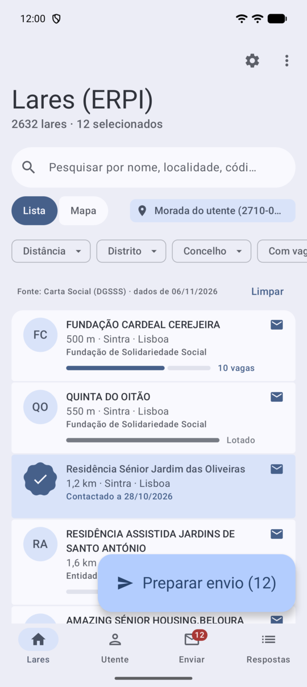
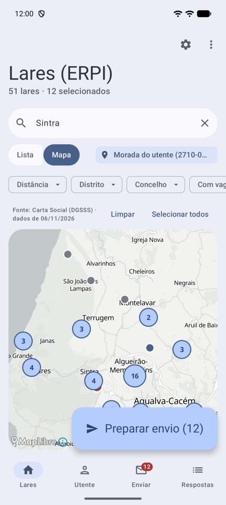
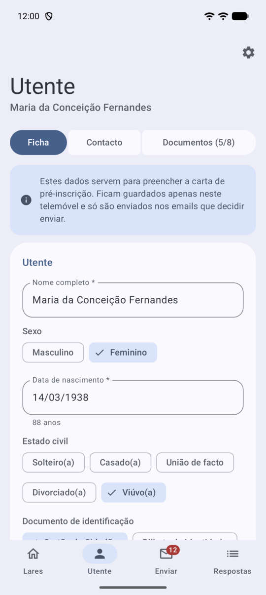
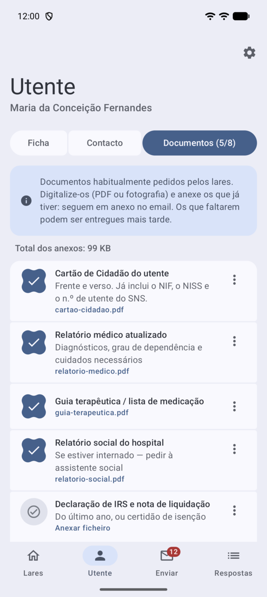
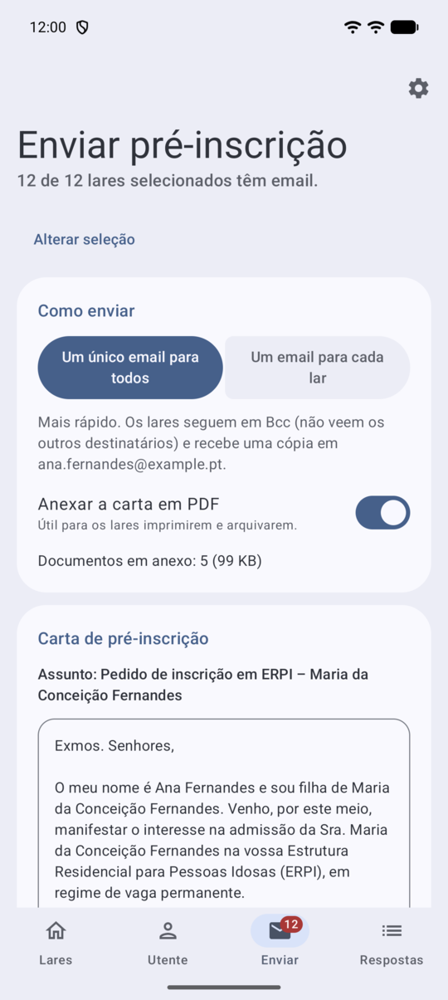
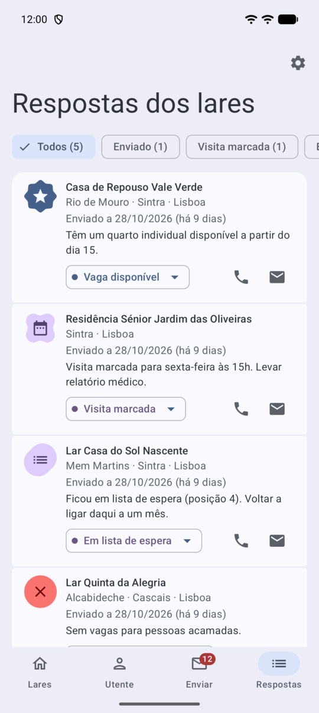

<h1 align="center">Avus</h1>

<strong>Pedir vaga num lar para um familiar, sem complicações.</strong>

O Avus ajuda as famílias a inscrever um familiar em Estruturas Residenciais para Pessoas Idosas (ERPI, os "lares") em Portugal. Escolhe os lares, preenche a ficha uma vez, e a app prepara a carta de pré-inscrição e o email, com os documentos em anexo. Depois, ajuda a acompanhar as respostas de cada lar.

> **O Avus não é um serviço de colocação nem intermediário.** Não tem qualquer ligação aos lares nem à Segurança Social: os emails são enviados por si, a partir da sua conta de email, e os lares respondem-lhe diretamente.

## Funcionalidades

### Encontrar lares
- **Lista oficial incluída:** todas as ERPI licenciadas de Portugal continental, segundo a [Carta Social](https://www.cartasocial.pt) (Direção-Geral da Solidariedade e Segurança Social).
- **Lista ou mapa**, com pesquisa e filtros por distrito, concelho e "Com vagas".
- **Ocupação** de cada lar (utentes e capacidade), tal como indicada à Carta Social.
- **Perto de…:** ordena os lares pela distância à morada do utente, do familiar, a um código postal ou a um concelho. A distância é calculada no telemóvel.

### Pedir vaga
- **Ficha do utente** (com Cartão de Cidadão ou Bilhete de Identidade) e do **familiar que contacta os lares**.
- **Lista de documentos** habitualmente pedidos, adaptada ao documento de identificação, com anexos (PDF ou fotografia).
- **Carta de pré-inscrição** gerada automaticamente e editável, também em PDF.
- **Um email para todos** os lares escolhidos (em Bcc, em grupos de até 30) ou **um email para cada lar**. A app abre a sua app de email já preenchida: só envia quando carregar em "Enviar".

### Acompanhar as respostas
- Estado de cada lar: enviado, respondeu, visita marcada, lista de espera, vaga disponível, sem vaga…
- **Partilhe a resposta de um lar** (texto de um email, mensagem…) para o Avus, que a regista no lar certo.
- Depois de telefonar a um lar, a app pergunta como correu.
- **Lembrete** quando um lar não responde há mais de uma semana.

### Privado
- Sem contas, sem anúncios, sem publicidade nem rastreio.
- Os seus dados e documentos ficam **apenas no telemóvel**. Pode exportar uma cópia de segurança para onde quiser.
- Veja a [política de privacidade](PRIVACIDADE.md).

## Capturas de ecrã

<table>
  <tr>
    <td></td>
    <td></td>
    <td></td>
  </tr>
  <tr>
    <td align="center">Lares, por distância</td>
    <td align="center">Mapa</td>
    <td align="center">Ficha do utente</td>
  </tr>
  <tr>
    <td></td>
    <td></td>
    <td></td>
  </tr>
  <tr>
    <td align="center">Documentos</td>
    <td align="center">Enviar</td>
    <td align="center">Respostas</td>
  </tr>
</table>

Capturas com dados fictícios: a utente, a familiar e os lares que aparecem em "Respostas" são exemplos e não existem.

## Instalar

- **Google Play:** brevemente.
- **APK:** descarregue a versão mais recente em [Releases](https://github.com/cruz-py/Avus-app/releases) (Android 8.0 ou mais recente; para a maioria dos telemóveis, o ficheiro `arm64-v8a`).

## Como começar

1. Em **Lares**, escolha os lares que lhe interessam (toque no círculo à esquerda de cada lar). Use o mapa ou "Perto de…" para encontrar os mais próximos.
2. Em **Utente**, preencha a **Ficha**, o **Contacto** (quem vai receber as respostas) e anexe os **Documentos** que já tiver.
3. Em **Enviar**, reveja a carta e carregue em **Abrir email**. Confirme na sua app de email.
4. Em **Respostas**, acompanhe cada lar e registe o que lhe disseram.

## Sobre a lista de lares

A lista vem da Carta Social e é atualizada com as novas versões da app. A ocupação e os contactos são os que cada lar indicou à Carta Social e podem estar desatualizados: confirme sempre com o lar. Se um lar não estiver na lista, pode acrescentá-lo na app. Se os dados de um lar estiverem errados, ou se for responsável por um lar e quiser que seja corrigido ou retirado, [abra um pedido](https://github.com/cruz-py/Avus-app/issues).

Açores e Madeira não estão incluídos (não fazem parte da Carta Social).

## Apoiar o projeto

O Avus é gratuito, sem anúncios e sem rastreio, e é feito no meu tempo livre. Se lhe foi útil e quiser ajudar no seu desenvolvimento, pode oferecer-me um café:

**[Doar com PayPal](https://www.paypal.com/paypalme/ruicruz27)**

## Problemas e sugestões

São bem-vindos em [Issues](https://github.com/cruz-py/Avus-app/issues).

## Componentes de código aberto

O Avus não é de código aberto. Usa estes componentes:

- **AndroidX / Jetpack Compose, Material 3, WorkManager** (Apache License 2.0).
- **MapLibre Native** (BSD 2-Clause) para o mapa.
- **Mapas:** © contribuidores do [OpenStreetMap](https://www.openstreetmap.org/copyright) (ODbL), servidos por [OpenFreeMap](https://openfreemap.org).
- **Dados dos lares:** [Carta Social](https://www.cartasocial.pt), DGSSS. Coordenadas aproximadas a partir dos códigos postais com [GEO API PT](https://geoapi.pt).
